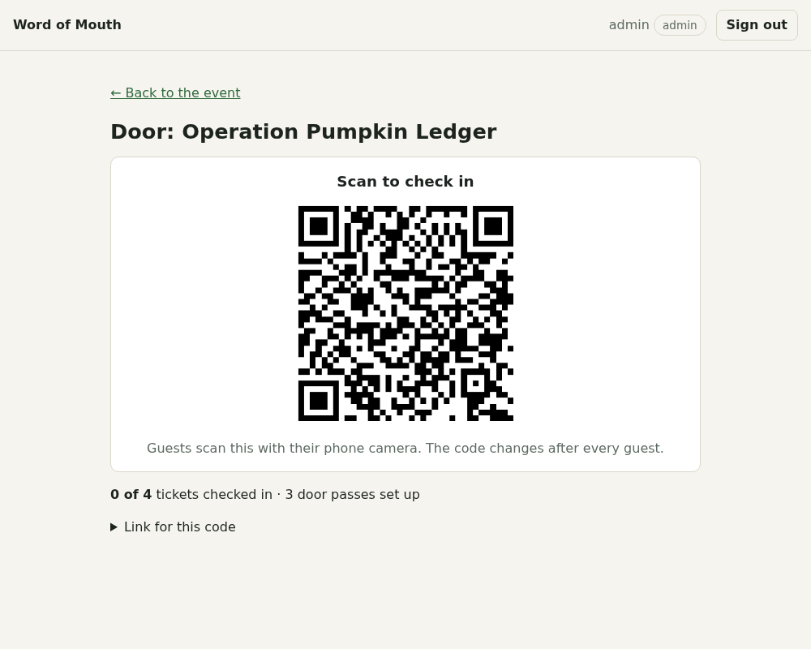

# Word of Mouth

Private events you can only find by walking to them.

An organizer seals the *when and where* of an event. The key is split across a few QR codes and NFC tags hidden around a short walk, so a guest has to physically go and find them before the details appear. Guests come in through invites that people pass to each other (hence the name), and they get in the door with a zero-knowledge proof instead of a ticket QR that can be copied.

Everything runs on your own machine: a self-hosted web app, a local open-weight model through [Ollama](https://ollama.com), and open map data. No accounts with anyone, no API keys.



## What it does

| Piece | How it works |
| --- | --- |
| **Sealed events** | The venue, address, time and notes are encrypted with AES-256-GCM when the event is created. The server sees them once, in memory, keeps only the ciphertext and a public ZIP code, and discards the key. |
| **Hidden codes** | The key is split with Shamir's secret sharing: any *k* of *n* codes (1 to 5) open the event. Each code is a printable QR or an NFC tag. The share rides in the URL `#fragment`, which browsers never send to a server. |
| **Roles** | `admin`, `coordinator`, `promoter`, `attendee`. Admins can do everything; a coordinator manages only their own events. |
| **Word of mouth** | A coordinator gives promoters a quota of single-use invite links. An invite is also the sign-up page, so accepting one creates the account and the ticket together. |
| **AI spot planner** | A local model picks real places from OpenStreetMap for the codes and writes themed clue lines. It never invents a place: it chooses from candidate IDs, and plain code checks distances, the walking limit, leaks and made-up scenery. Any spot can also be set by hand. |
| **ZK door check-in** | A ticket holder's phone makes a private pass. At the door the phone proves "I'm on the guest list" for a one-time code, without the server learning which guest it was. Reusing a pass is refused. |

## Run it with Docker

```bash
WOM_ADMIN_PASSWORD='a long password' docker compose up --build
```

Open <http://localhost:3000> and sign in as `admin`. The admin is created on the first start only, when the database is empty. Data lives in the `wom-data` volume.

Point it at your Ollama server (the default is Ollama on the same machine):

```bash
OLLAMA_URL=http://192.168.1.50:11434 OLLAMA_MODEL=qwen3:4b-instruct-2507-q4_K_M \
WOM_ADMIN_PASSWORD='a long password' docker compose up --build
```

The image builds with the zero-knowledge circuit files included (about 29 MB), so nothing is fetched from a third-party CDN at the door. Set `COOKIE_SECURE=true` once you serve it over HTTPS. NFC writing from a phone needs HTTPS and Chrome on Android.

## Run it for development

```bash
pnpm install
pnpm fetch-zk                         # downloads the circuit files into public/zk (once)
cp .env.example .env.local            # set OLLAMA_URL
WOM_ADMIN_PASSWORD='a long password' pnpm dev   # creates the first admin on first start
```

| Command | What it does |
| --- | --- |
| `pnpm test` | 49 unit tests, including door check-in tests that use real zero-knowledge proofs |
| `pnpm typecheck` | TypeScript |
| `pnpm screenshots` | Drives the running app in headless Chrome and saves screenshots to `docs/screenshots` |
| `pnpm tsx scripts/e2e-door.mts` | Real-browser test of the whole door flow (set `BASE` and `ADMIN_PASSWORD`) |

## Configuration

| Variable | Default | Meaning |
| --- | --- | --- |
| `OLLAMA_URL` | `http://localhost:11434` | Your Ollama server |
| `OLLAMA_MODEL` | `qwen3:4b-instruct-2507-q4_K_M` | Any model your server has; it must follow a JSON schema |
| `OVERPASS_URL` | three public mirrors | Comma-separated Overpass servers. Point at your own for fully offline planning |
| `DATABASE_FILE` | `data/wom.db` (`/data/wom.db` in Docker) | SQLite file |
| `WOM_ADMIN_USER`, `WOM_ADMIN_PASSWORD` | `admin`, unset | Creates the first admin when the database has no users |
| `COOKIE_SECURE` | `false` | Set `true` behind HTTPS |

## Privacy and security: what it does and does not do

- **The server does not keep the key, but it does see the secrets once.** Encryption happens on the server when you create the event, so it handles the plaintext in memory at that moment (and so does the local model, below). After that it stores only the ciphertext, the ZIP, and the clues, so a copy of the database does not reveal the venue or address. The codes exist only on paper and tags: they are shown once when you create an event, and if you lose them you create the event again. Run it on a machine you trust.
- **The local model does see the secrets.** To stop it leaking them into clues, the planner tells it which words to avoid, and those words come from the venue and address. That is why it runs on your own Ollama server and not a hosted API.
- **Door check-in is not magic.** Registering a pass links a public fingerprint to a ticket, so the server knows that much. After that, a check-in stores only a one-time token with no link to a ticket or account. Groups smaller than 3 are not meaningfully anonymous, and the door screen warns you. Someone standing at the door can still see who walks in.
- **It does not stop resale.** The pass lives on one phone, and a phone or an account can be handed over. It does stop a copied QR or a screenshot, because there is no static ticket QR, and it stops the same pass being used twice.
- **No pass re-issue and no offline door.** A lost phone means a lost pass, and the phone needs a connection at the door.
- **Only put codes where you have permission.** The app reminds you, and so should you.
- The code has not been security-audited. The zero-knowledge part relies on [Semaphore](https://semaphore.pse.dev)'s public trusted setup.

## Built with

[Next.js](https://nextjs.org), TypeScript, SQLite ([better-sqlite3](https://github.com/WiseLibs/better-sqlite3)), [Ollama](https://ollama.com) with Qwen3 4B Instruct (Apache 2.0), [OpenStreetMap](https://www.openstreetmap.org) via Overpass, [Semaphore](https://semaphore.pse.dev) with [snarkjs](https://github.com/iden3/snarkjs), [shamir-secret-sharing](https://github.com/privy-io/shamir-secret-sharing), Playwright, Vitest.

## License

Word of Mouth is free software, licensed under the **GNU General Public License v3.0 or later** (`GPL-3.0-or-later`). See [LICENSE](LICENSE).

It is GPL because the zero-knowledge proofs use [snarkjs](https://github.com/iden3/snarkjs), which is GPL-3.0, and the app ships it in the Docker image and to guests' browsers. The other dependencies are MIT or Apache-2.0, both compatible with GPLv3, and so are the Semaphore circuits (MIT). Qwen3 is Apache-2.0.

### Map data

Places come from [OpenStreetMap](https://www.openstreetmap.org/copyright). © OpenStreetMap contributors, available under the [Open Database License](https://opendatacommons.org/licenses/odbl/). The app shows that credit wherever suggested places appear. Lookups are cached in your own SQLite file (`osm_cache`) and are not republished.
