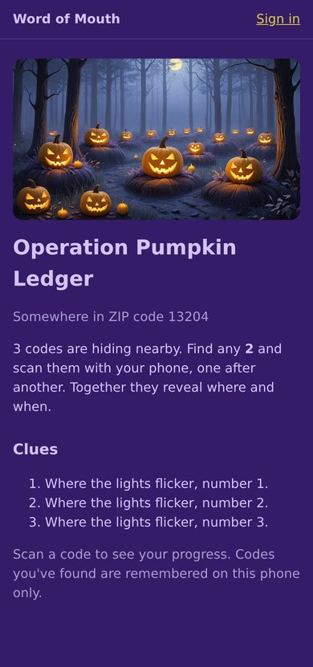
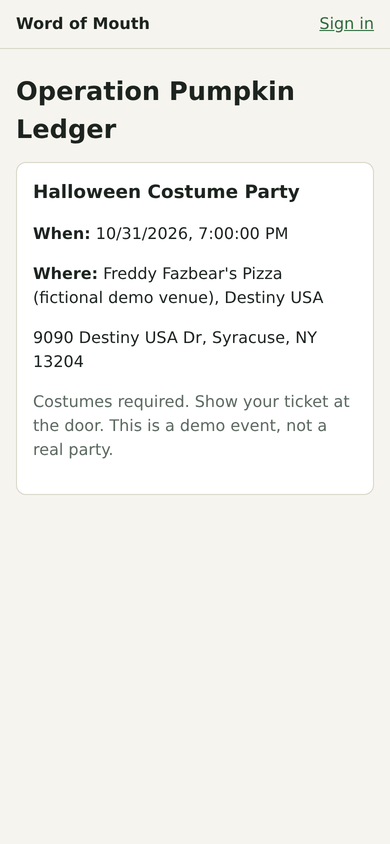
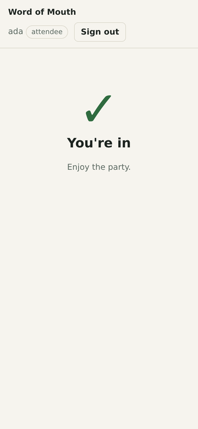
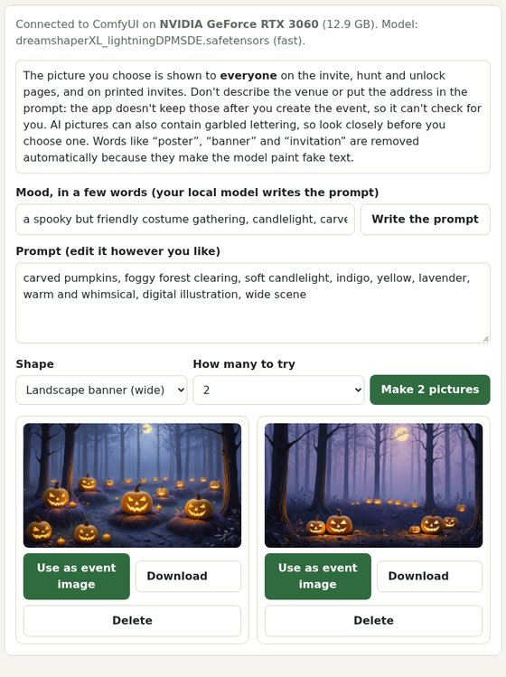
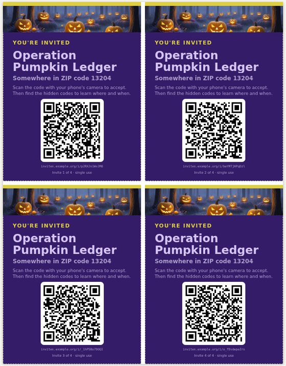
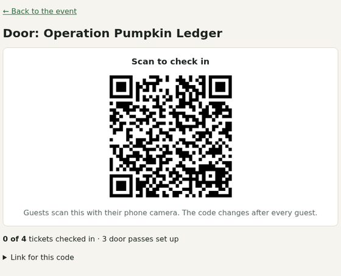

# Word of Mouth

Private events you can only find by walking to them.

An organizer seals the *when and where* of an event. The key is split across a few QR codes and NFC tags hidden around a short walk, so a guest has to physically go and find them before the details appear. Guests come in through invites that people pass to each other (hence the name), and they get in the door with a zero-knowledge proof instead of a ticket QR that can be copied.

Everything runs on your own machine: a self-hosted web app, a local open-weight language model through [Ollama](https://ollama.com), your own [ComfyUI](https://github.com/comfyanonymous/ComfyUI) for pictures, and open map data. No accounts with anyone, no API keys.

<table>
  <tr>
    <td align="center" valign="top"><br><sub><b>Find it.</b> A guest sees the event's theme and artwork, a ZIP code and clues. Nothing else.</sub></td>
    <td align="center" valign="top"><br><sub><b>Unlock it.</b> Find enough hidden codes and the details decrypt on the phone.</sub></td>
    <td align="center" valign="top"><br><sub><b>Get in.</b> At the door the phone proves it's on the guest list, once.</sub></td>
  </tr>
</table>

<table>
  <tr>
    <td align="center" valign="top"><br><sub><b>Make it yours.</b> Your local model writes the prompt, ComfyUI paints candidates, you choose one.</sub></td>
    <td align="center" valign="top"><br><sub><b>Print it.</b> Unique single-use invites, 1, 2, 4 or 8 to a sheet.</sub></td>
    <td align="center" valign="top"><br><sub><b>Run the door.</b> A one-time QR that changes after every guest.</sub></td>
  </tr>
</table>

## What it does

| Piece | How it works |
| --- | --- |
| **Sealed events** | The venue, address, time and notes are encrypted with AES-256-GCM when the event is created. The server sees them once, in memory, keeps only the ciphertext and a public ZIP code, and discards the key. |
| **Hidden codes** | The key is split with Shamir's secret sharing: any *k* of *n* codes (1 to 5) open the event. Each code is a printable QR or an NFC tag. The share rides in the URL `#fragment`, which browsers never send to a server. |
| **Roles** | `admin`, `coordinator`, `promoter`, `attendee`. Admins can do everything; a coordinator manages only their own events. |
| **Word of mouth** | A coordinator gives promoters a quota of single-use invite links. An invite is also the sign-up page, so accepting one creates the account and the ticket together. |
| **AI spot planner** | A local model picks real places from OpenStreetMap for the codes and writes themed clue lines. It never invents a place: it chooses from candidate IDs, and plain code checks distances, the walking limit, leaks and made-up scenery. Any spot can also be set by hand. |
| **Themes** | 25 built-in color themes (the app's default plus 24 from Figma's palettes) and custom colors, applied to the invite, hunt, unlock and ticket pages and to printed invites. Every theme is adjusted so text, links and buttons meet WCAG 4.5:1 contrast, and the tests check all of them. |
| **Bulk print invites** | A promoter picks a number and gets that many unique single-use invite cards as a print sheet: 1, 2, 4 or 8 per sheet on Letter or A4, vector QR codes at the highest error correction, cut guides, and an ink-saver mode. Reprints skip invites already used. |
| **Event pictures** | Your local model writes an image prompt from a few words of mood, and ComfyUI paints candidates. The one you choose appears on the public pages and on printed cards; the others stay private. Prompts and workflows that ComfyUI embeds in its PNGs are stripped before anything is stored. |
| **ZK door check-in** | A ticket holder's phone makes a private pass. At the door the phone proves "I'm on the guest list" for a one-time code, without the server learning which guest it was. Reusing a pass is refused. |

## Run it with Docker

```bash
WOM_ADMIN_PASSWORD='a long password' docker compose up --build
```

Open <http://localhost:3000> and sign in as `admin`. The admin is created on the first start only, when the database is empty. Data lives in the `wom-data` volume.

Point it at your Ollama and ComfyUI servers (the defaults are Ollama and ComfyUI on the same machine), and tell it the address guests will use so printed invites work:

```bash
OLLAMA_URL=http://192.168.1.50:11434 OLLAMA_MODEL=gemma3:4b \
COMFYUI_URL=http://192.168.1.50:8188 PUBLIC_BASE_URL=https://invites.example.com \
WOM_ADMIN_PASSWORD='a long password' docker compose up --build
```

Pictures are stored in the same `wom-data` volume as the database.

The image builds with the zero-knowledge circuit files included (about 29 MB), so nothing is fetched from a third-party CDN at the door. Set `COOKIE_SECURE=true` once you serve it over HTTPS. NFC writing from a phone needs HTTPS and Chrome on Android.

## Run it for development

```bash
pnpm install
pnpm fetch-zk                         # downloads the circuit files into public/zk (once)
cp .env.example .env.local            # set OLLAMA_URL and COMFYUI_URL
WOM_ADMIN_PASSWORD='a long password' pnpm dev   # creates the first admin on first start
```

| Command | What it does |
| --- | --- |
| `pnpm test` | 211 unit tests, including door check-in tests that use real zero-knowledge proofs and a contrast check on every theme |
| `pnpm typecheck` | TypeScript |
| `pnpm screenshots` | Drives the running app in headless Chrome and saves screenshots to `docs/screenshots` |
| `pnpm tsx scripts/e2e-door.mts` | Real-browser test of the whole door flow (set `BASE` and `ADMIN_PASSWORD`) |
| `pnpm tsx scripts/e2e-print.mts` | Makes a batch of invites, renders every paper and layout, reads each QR code back out of the rendered pixels, measures its printed size in millimetres (it must be 30 mm or more), and checks that nothing runs past a card's edge, including with a very long event name |
| `pnpm tsx scripts/e2e-images.mts` | Needs real Ollama and ComfyUI: writes a prompt, paints pictures, and checks the privacy rules and the printed cards |

## Configuration

| Variable | Default | Meaning |
| --- | --- | --- |
| `OLLAMA_URL` | `http://localhost:11434` | Your Ollama server |
| `OLLAMA_MODEL` | `gemma3:4b` | Any model your server has; it must follow a JSON schema. `qwen3:4b-instruct-2507-q4_K_M` is also tested and works well |
| `COMFYUI_URL` | `http://localhost:8188` | Your ComfyUI server, for event pictures |
| `COMFYUI_CHECKPOINT` | a fast one if installed | Checkpoint file name to use. A "lightning" or "turbo" model is chosen by default, which suits a GPU shared with a language model |
| `PUBLIC_BASE_URL` | the address you open the app at | What printed invite QR codes point at. It must be reachable from guests' phones; the print page warns about `localhost` and private addresses |
| `DATA_DIR` | next to the database | Where pictures are stored |
| `OVERPASS_URL` | three public mirrors | Comma-separated Overpass servers. Point at your own for fully offline planning |
| `DATABASE_FILE` | `data/wom.db` (`/data/wom.db` in Docker) | SQLite file |
| `WOM_ADMIN_USER`, `WOM_ADMIN_PASSWORD` | `admin`, unset | Creates the first admin when the database has no users |
| `COOKIE_SECURE` | `false` | Set `true` behind HTTPS |

## Privacy and security: what it does and does not do

- **The server does not keep the key, but it does see the secrets once.** Encryption happens on the server when you create the event, so it handles the plaintext in memory at that moment (and so does the local model, below). After that it stores only the ciphertext, the ZIP, and the clues, so a copy of the database does not reveal the venue or address. The codes exist only on paper and tags: they are shown once when you create an event, and if you lose them you create the event again. Run it on a machine you trust.
- **The local model does see the secrets.** To stop it leaking them into clues, the planner tells it which words to avoid, and those words come from the venue and address. That is why it runs on your own Ollama server and not a hosted API.
- **The picture you choose is public.** It's shown on the invite, hunt and unlock pages and on printed cards. The server doesn't keep the venue or address after creation, so it **cannot check an image prompt against them**; the studio says so, and you must not describe the venue in a prompt. Pictures you don't choose are private to the event's coordinator and admins. ComfyUI embeds the prompt and the whole workflow in every PNG, so that metadata is removed before a picture is stored (the pixels are untouched). AI pictures can contain garbled lettering: words like "poster", "banner" and "invitation" are stripped from prompts because they cause it, but look closely before you choose one.
- **Printed invites carry real, single-use links.** Anyone holding a card can accept it once, so treat a stack like cash. A promoter can only print their own unused invites, and revoking or using one removes it from future prints.
- **Door check-in is not magic.** Registering a pass links a public fingerprint to a ticket, so the server knows that much. After that, a check-in stores only a one-time token with no link to a ticket or account. Groups smaller than 3 are not meaningfully anonymous, and the door screen warns you. Someone standing at the door can still see who walks in.
- **It does not stop resale.** The pass lives on one phone, and a phone or an account can be handed over. It does stop a copied QR or a screenshot, because there is no static ticket QR, and it stops the same pass being used twice.
- **No pass re-issue and no offline door.** A lost phone means a lost pass, and the phone needs a connection at the door.
- **Only put codes where you have permission.** The app reminds you, and so should you.
- The code has not been security-audited. The zero-knowledge part relies on [Semaphore](https://semaphore.pse.dev)'s public trusted setup.

## Built with

[Next.js](https://nextjs.org), TypeScript, SQLite ([better-sqlite3](https://github.com/WiseLibs/better-sqlite3)), [Ollama](https://ollama.com) with Gemma 3 4B (Gemma Terms of Use), [ComfyUI](https://github.com/comfyanonymous/ComfyUI) for pictures, [sharp](https://sharp.pixelplumbing.com) (Apache 2.0) for resizing, [qrcode](https://github.com/soldair/node-qrcode) for QR codes, [OpenStreetMap](https://www.openstreetmap.org) via Overpass, [Semaphore](https://semaphore.pse.dev) with [snarkjs](https://github.com/iden3/snarkjs), [shamir-secret-sharing](https://github.com/privy-io/shamir-secret-sharing), Playwright, Vitest.

## License

Word of Mouth is free software, licensed under the **GNU General Public License v3.0 or later** (`GPL-3.0-or-later`). See [LICENSE](LICENSE).

It is GPL because the zero-knowledge proofs use [snarkjs](https://github.com/iden3/snarkjs), which is GPL-3.0, and the app ships it in the Docker image and to guests' browsers. The other dependencies are MIT or Apache-2.0, both compatible with GPLv3, and so are the Semaphore circuits (MIT). Models are separate; see below.

### Color themes

24 of the 25 themes are built from palettes in Figma's [website color schemes](https://www.figma.com/resource-library/website-color-schemes/) collection; only the colors were used (read from the published swatches, so a channel can be off by 1). Each theme's number in that collection is in `src/lib/themes.ts`. Choosing which color is the background, text and accent, and adjusting colors for contrast, is this project's own work. That page states no license for its palettes, so credit and a link are given here.

### Models

The app doesn't ship any model. You supply an Ollama language model and ComfyUI checkpoints. The default language model, Gemma 3 4B, is released by Google under the [Gemma Terms of Use](https://ai.google.dev/gemma/terms) (as reported by Ollama): open weights you can run and modify, but not an OSI open-source license, and with a prohibited-use policy. Qwen3 4B Instruct, which also works well here, is Apache-2.0. Check the license of whichever image checkpoint you use before putting its pictures on printed material, since some are non-commercial.

### Map data

Places come from [OpenStreetMap](https://www.openstreetmap.org/copyright). © OpenStreetMap contributors, available under the [Open Database License](https://opendatacommons.org/licenses/odbl/). The app shows that credit wherever suggested places appear. Lookups are cached in your own SQLite file (`osm_cache`) and are not republished.
